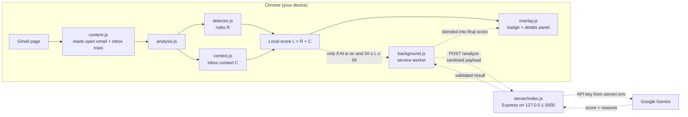

# PhishGuard

PhishGuard is a privacy-conscious Chrome extension (Manifest V3) for Gmail. It scores the email you have open for phishing risk and explains its reasoning.

- **Local detection first.** Rule-based checks and inbox-context checks run in your browser.
- **Optional AI review.** If you turn it on, a small Node.js backend asks Google Gemini for a second opinion, but only when the local score is uncertain.
- **Explainable results.** Every score comes with the specific signals behind it, grouped by category, plus a recommended action.
- **You stay in control.** AI review is off by default. Turning it off stops further requests and removes the extension's access to the backend.

> PhishGuard is a hackathon project. Its scores are heuristic estimates. They can't prove that an email is safe or malicious, and they haven't been measured against a labeled dataset.

## Contents

- [Key features](#key-features)
- [Architecture](#architecture)
- [Privacy and security](#privacy-and-security)
- [Installation and setup](#installation-and-setup)
- [Usage](#usage)
- [Testing](#testing)
- [Project structure](#project-structure)
- [Deployment](#deployment)
- [Limitations and future work](#limitations-and-future-work)

## Key features

### Rule-based checks (`detector.js`)

| Signal | Points |
|---|---|
| Urgent language or threatened account consequences ("act now", "account will be suspended", "verify your account") | +22 |
| Mentions of passwords, card or bank details, one-time codes, wire transfers or gift cards | +25 |
| Contains links | +8 |
| A link uses a URL shortener, punycode (`xn--`), a raw IP address, or a lookalike domain for a brand named in the email | +30 |
| A link points to a domain other than the sender's | +10 |

The rule score R is capped at 100.

### Inbox-context checks (`context.js`)

These checks compare the open email with other recent messages visible in your Gmail inbox (up to 50 rows):

- **Sender identity:**
  - The sender claims a known brand (in the display name, a leading subject prefix, or the sender domain) but mails from a domain that brand doesn't use.
  - A business-style message comes from a personal free-mail account.
  - The sender doesn't appear in your other recent emails.
- **Unverified claims:** the email mentions a package delivery, a refund or prize, an invoice, or a security alert, but no related recent email backs it up.
- **Unusual requests:**
  - An unfamiliar sender asks you to buy gift cards, send money, change payment details, keep a secret, pay a small fee, enter login or card details, open an attachment, or call a number.
  - A known sender makes a money or secrecy request. This is flagged as a possible compromised account.

Each finding adds weight. The context score C is capped at 40. If recent inbox emails can't be read, PhishGuard says so instead of guessing.

### Scoring

- **Local score:** L = min(100, R + C). Context is counted exactly once.
- **Verdicts:** 60 or more is **High risk**, 30–59 is **Use caution**, and below 30 is **Lower risk**.
- **When AI is asked:** only if AI review is enabled and L is between 20 and 59. Lower scores skip AI to save cost and time. Higher scores warn immediately.
- **How the AI score is blended:** the final score is 30% L and 70% the AI score.
  - Without strong evidence, AI can lower the score by at most 25 points.
  - With strong evidence, the score never drops below L. Strong evidence means a suspicious link (from the table above) or a sender impersonating a brand.
- **Fallback:** if AI is off, not needed, times out, or returns an error or invalid output, the local result is shown. The overlay says which of these happened.

### Gmail overlay (`overlay.js`)

- **Automatic scan:** each email you open is scanned. A risk badge appears on the subject row, for example `High risk · 78%`.
- **Details panel:** clicking the badge opens a panel with these parts:
  - The overall risk.
  - A signal-breakdown chart, shown when at least two categories fired.
  - The detected signals, grouped as Message & links, Sender identity, Unverified claims, Unusual requests, Inbox context, and AI review.
  - A recommended action.
- **Status footer:** the footer states exactly how the result was produced: local only, AI not needed, AI unavailable, or AI-reviewed.
- **Controls:** Escape, the close button, or a click outside the panel closes it. If analysis fails or takes more than 12 seconds, a **Try again** button appears.
- **Isolation:** the overlay renders inside a shadow DOM, so Gmail's styles don't affect it.

### Popup (`popup.html`, `popup.js`)

- **Analyze open email:** runs a manual scan using the rules and context checks only. This scan never uses AI.
- **AI review in Gmail:** the opt-in toggle. Next to it is a disclosure of exactly what is sent and where.

## Architecture



Solid arrows show the local path, which always runs. Dotted arrows show the optional AI path.

| Component | Responsibility |
|---|---|
| `content.js` | Finds the open message in Gmail's DOM. It reads the subject, sender, body text and real link targets, unwrapping Google redirect links. It triggers the overlay and keeps the original score card as a fallback. |
| `detector.js` | Rule scoring, the AI eligibility policy, score blending, and validation of AI responses. |
| `context.js` | Reads recent inbox rows and runs the sender, claim and request checks. Runs only in the page. |
| `analysis.js` | Wires the rules, context and optional AI together. It routes AI requests to the background worker through `chrome.runtime.sendMessage`. |
| `overlay.js` | The badge, details panel, status messages and accessibility behavior. |
| `background.js` | The only extension code that contacts the backend. It checks the message sender, consent and permission, rebuilds the payload, enforces timeouts and sanitizes replies. |
| `server/index.js` | Validates requests, calls Gemini with structured JSON output, and re-validates the model's output. |

### Backend API

`POST /analyze` with `Content-Type: application/json`.

Request:

```json
{
  "email": {
    "subject": "string (≤ 1000 chars)",
    "sender": "string (≤ 320 chars)",
    "body": "string (≤ 50000 chars)",
    "links": ["string (≤ 2048 chars each, ≤ 200 items)"]
  },
  "context": {
    "score": 0,
    "reasons": ["string (≤ 500 chars each, ≤ 20 items)"]
  }
}
```

`context` is optional and may be `null`, and `context.score` is a number from 0 to 100. The JSON body limit is 100 kb. The model sees at most the first 12,000 characters of the body and the first 50 links.

Successful response (`200`):

```json
{ "score": 72, "reasons": ["Up to 5 short reasons, each under 200 characters"] }
```

Error responses have the shape `{ "error": "<fixed message>" }`:

| Status | Meaning |
|---|---|
| `400` | Invalid JSON or a field that fails validation |
| `413` | Request body too large |
| `503` | `GEMINI_API_KEY` or `GEMINI_MODEL` not configured |
| `504` | The Gemini call exceeded 7 seconds |
| `502` | The provider call failed, or the model returned an invalid result |
| `404` | Any other route |

## Privacy and security

**What stays local.** The rule checks, the inbox-context checks, and the popup's manual scan all run in your browser. The inbox rows used for context checks are never sent anywhere, and neither is the per-finding detail.

**AI review is opt-in.** It is off by default. Turning it on in the popup asks Chrome for the optional host permission `http://127.0.0.1:3000/*`, and AI stays off if you decline. Turning it off removes that permission. Removing the permission in `chrome://extensions` also turns AI review off.

**What is sent when AI review runs.** AI review runs only for emails with a local score from 20 to 59. For those emails, `background.js` sends the following to the backend, and nothing else:

| Field | Limit |
|---|---|
| Subject | Up to 1,000 characters |
| Sender address | Up to 320 characters |
| Body | First 12,000 characters |
| Links | Up to 50 `http`/`https` links |
| Context findings | The context score and up to 20 short reason strings |

The whole request is limited to 90,000 bytes. The backend then sends the email fields and findings to Google Gemini. Gemini's handling of that data is governed by Google's terms; see the note in `server/.env.example` about using a billing-enabled project.

**Request hardening (background worker):**

- **Who may ask:** only requests from this extension's own content script, in Gmail's top frame on `https://mail.google.com`, are accepted.
- **Consent:** the setting and the permission are re-checked on every request.
- **Payload:** it is rebuilt from an allow-list of fields, and unknown fields are dropped.
- **Fetch options:** `credentials: "omit"`, `cache: "no-store"`, `redirect: "error"`.
- **Timeouts:** server 7 s < worker 7.5 s < content script 8 s < overlay guard 12 s.
- **Replies:** errors are reduced to fixed codes and contain no backend text, provider text or email content. AI scores and reasons are re-validated and capped at 5 reasons of 200 characters each.

**Prompt-injection handling (backend):**

- The system prompt marks the email as untrusted data. It tells the model never to follow instructions inside the email and to treat attempts to steer the assessment as a phishing signal.
- Model output is constrained by a JSON schema and validated again on the server.

**Secrets.**

- The Gemini API key lives only in `server/.env`, which git ignores. Never commit it.
- The key must never be placed in extension code. The extension contains no key or Gemini client.
- Server logs record only an error category, never email content, provider responses or secrets.

**Limits of the scores.** Scores are estimates. A low score does not mean an email is safe, and a high score does not prove it is malicious. Verify sensitive requests through a channel you already trust.

## Installation and setup

Requirements: Google Chrome, Git, and Node.js 22 or newer (the backend's `engines` setting). Node is needed only for the AI backend and the tests.

### 1. Clone

```bash
git clone https://github.com/eliasMohamadi/PhishGuard.git
cd PhishGuard
```

### 2. Load the extension

1. Open `chrome://extensions`.
2. Turn on **Developer mode**.
3. Click **Load unpacked** and select the repository root, which is the folder containing `manifest.json`.

At this point the extension works fully in local mode. The backend is needed only for AI review.

### 3. Run the backend (optional, for AI review)

```bash
cd server
npm install
cp .env.example .env              # PowerShell: Copy-Item .env.example .env
```

Edit `server/.env` and set these two values:

```ini
GEMINI_API_KEY=your-gemini-api-key-here
GEMINI_MODEL=gemini-3.1-flash-lite
```

The example file also sets `PORT=3000` and `HOST=127.0.0.1`. Keep these values: the extension only talks to `http://127.0.0.1:3000`.

Then start the server:

```bash
npm start
```

It logs `PhishGuard server listening on http://127.0.0.1:3000`. If the key or model is missing, it starts anyway and `/analyze` returns `503`.

### 4. Enable AI review

Click the PhishGuard toolbar icon. Turn on **AI review in Gmail** and allow access to `127.0.0.1:3000` when Chrome asks.

## Usage

1. Open or refresh Gmail, then open an email.
2. A badge appears on the subject row: **Lower risk**, **Use caution** or **High risk**, with the score.
3. Click the badge to see the score, the signals grouped by category, and a recommended action. The footer shows whether AI review was used.
4. Close the panel with Escape, the close button, or a click anywhere outside it.
5. The popup's **Analyze open email** button runs a manual local scan, and its toggle switches AI review on or off. Changing the toggle re-analyzes the open email.

## Testing

All tests use Node's built-in test runner, so the extension tests need no `npm install`.

```bash
# Extension: detector, analysis pipeline, background worker, and headless-Chrome overlay tests
node --test "tests/*.test.js"

# Backend (from server/, after npm install)
cd server && npm test
```

- **Browser tests:** `tests/overlay.browser.test.js` drives `tests/browser/overlay-test.html` in headless Chrome. It is skipped if Chrome isn't found; set `CHROME_PATH` to point at a Chrome or Chromium binary.
- **Glob syntax:** keep the quotes around `"tests/*.test.js"`. Passing a bare directory (`node --test tests/`) doesn't work on recent Node versions.
- **No live calls:** the backend tests use a stubbed Gemini client and make no network calls.

Last run on Windows 11 with Node 24 and Chrome installed: extension tests **88/88 passed**, backend tests **29/29 passed**.

These tests check behavior: scoring rules, policy, payload sanitization, error handling, and overlay rendering. They do not measure real-world detection accuracy.

## Project structure

```
PhishGuard/
├── manifest.json        # MV3 manifest: Gmail content scripts, background worker, permissions
├── content.js           # Reads the open Gmail message; triggers the overlay
├── detector.js          # Rule scoring, AI policy, score blending
├── context.js           # Inbox-context checks (sender, claims, requests)
├── analysis.js          # Pipeline wiring; routes AI requests to the worker
├── overlay.js           # Badge and details panel (shadow DOM)
├── background.js        # Service worker: the only path to the backend
├── popup.html / popup.css / popup.js   # Manual scan and AI opt-in
├── server/
│   ├── index.js         # Express app: POST /analyze → Gemini
│   ├── index.test.js
│   ├── package.json
│   └── .env.example     # Copy to .env (git-ignored)
├── tests/
│   ├── detector.test.js
│   ├── analysis.test.js
│   ├── background.test.js
│   ├── overlay.browser.test.js
│   └── browser/overlay-test.html
├── website/             # Static landing page (see website/README.md)
└── prototype/overlay-preview.html
```

## Deployment

- **Extension:** available as an unpacked developer build only. It is not published on the Chrome Web Store.
- **Backend:** runs locally on `127.0.0.1:3000`. No hosted backend exists, and the extension's endpoint and optional permission are both fixed to that local address.
- **Website:** a static landing page with no build step, previewed with `node website/serve.js` at `http://127.0.0.1:4173`. It hasn't been deployed; publishing notes are in [`website/README.md`](website/README.md).

## Limitations and future work

**Current limitations**

- **Detection logic:** detection uses fixed rules and brand lists, and the regexes target English wording. PhishGuard does not inspect attachments, email headers (SPF, DKIM, DMARC), or the pages behind links.
- **No accuracy figures:** precision, recall and false-positive rates have not been measured.
- **Gmail DOM dependence:** Gmail's DOM changes over time, and the message and inbox selectors are best-effort.
- **Inbox context coverage:** the context checks only see inbox rows that are currently loaded in the page.
- **Backend:**
  - It has no authentication or rate limiting, so it is meant for local use only.
  - It makes a single Gemini attempt per request, with no retry.
  - Provider errors are reported generically.

**Possible future work**

- Larger and more diverse labeled evaluation datasets, with measured precision, recall and false-positive rates.
- Chrome Web Store publication.
- A hardened hosted backend: authentication, rate limiting, abuse prevention, a configurable endpoint, and updated privacy disclosures.
- Header-based sender authentication signals and more languages.
